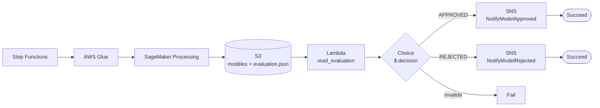

# AutoMLOps Lab

**Automatisation du cycle de vie du Machine Learning avec Python et AWS**

Pipeline MLOps qui entraîne plusieurs modèles candidats, les compare à un modèle de référence (Baseline), applique des critères de qualité (Quality Gate) et décide automatiquement de **promouvoir** ou de **rejeter** un nouveau modèle, puis notifie le résultat par email.


---

## Sommaire

- [Objectif](#objectif)
- [Architecture](#architecture)
- [Stack technique](#stack-technique)
- [Dataset](#dataset)
- [Pipeline ML](#pipeline-ml)
- [Quality Gate](#quality-gate)
- [Stockage S3](#stockage-s3)
- [Orchestration Step Functions](#orchestration-step-functions)
- [Notifications SNS](#notifications-sns)
- [Monitoring](#monitoring)
- [Structure du dépôt](#structure-du-dépôt)
- [Déploiement](#déploiement)
- [Documentation](#documentation)
- [Compétences démontrées](#compétences-démontrées)

---

## Objectif

Dans un processus classique, un Data Scientist entraîne un modèle, évalue ses performances et décide manuellement s'il peut passer en production. Ce projet automatise cette logique :

| Décision | Signification |
|---|---|
| ✅ **APPROVED** | Un candidat satisfait les critères de qualité et remplace le modèle actif. |
| ❌ **REJECTED** | Aucun candidat ne satisfait les critères : le Baseline reste le modèle actif. |

L'objectif est de garantir que chaque nouveau modèle déployé présente un niveau de performance acceptable et **ne dégrade pas** la qualité du modèle déjà utilisé.

---

## Architecture



| Service | Rôle |
|---|---|
| **Amazon S3** | Stockage partagé : code, données, modèles, rapports |
| **AWS Glue** | Étape de traitement des données du workflow |
| **Amazon SageMaker Processing** | Exécution du pipeline ML dans un environnement géré |
| **AWS Lambda** | Lecture du rapport et détermination de la décision |
| **AWS Step Functions** | Orchestration de l'ensemble du workflow |
| **Amazon SNS** | Notification du résultat |
| **Amazon CloudWatch** | Logs et suivi des exécutions |

---

## Stack technique

| Technologie | Rôle |
|---|---|
| Python | Pipelines ML et logique métier |
| Scikit-learn | Entraînement, validation et comparaison des modèles |
| Pandas | Chargement et manipulation des données |
| Joblib | Sauvegarde et chargement des modèles |
| Boto3 | Interaction entre Python et les services AWS |
| Git / GitHub | Gestion des versions |

---

## Dataset

**Breast Cancer Wisconsin (Diagnostic)** : classification binaire pour distinguer les tumeurs malignes et bénignes.

- 569 observations, 30 variables explicatives, 1 variable cible (`target`)
- Convention adoptée dans le pipeline : **1 = Malignant, 0 = Benign**

Le projet privilégie la détection des cas malins : un faux négatif (tumeur maligne classée bénigne) est le cas le plus coûteux. Le critère principal est donc le **Recall** de la classe maligne, et pas seulement l'accuracy.

> Le dataset n'est pas versionné dans ce dépôt. Voir [docs/dataset.md](docs/dataset.md).
> Ce projet est un exercice pédagogique, **pas un outil de diagnostic médical**.

---

## Pipeline ML

Le pipeline est exécuté dans **SageMaker Processing**. Le fichier `sagemaker/launcher.py` sert de point d'entrée : il récupère les scripts depuis S3, prépare l'environnement et exécute le module `src.training.pipeline`.

### 1. Préparation des données
- Chargement depuis S3 avec Pandas
- Vérifications : présence de la cible, absence de valeurs manquantes, présence des deux classes
- Séparation **train / test stratifiée**

### 2. Modèle de référence (Baseline)
Pipeline Scikit-learn : `StandardScaler` + `LogisticRegression` (`max_iter=2000`, `random_state=42`).

### 3. Modèles candidats

| Algorithme | Description |
|---|---|
| Logistic Regression | Modèle de référence |
| Random Forest | Ensemble d'arbres de décision |
| SVM | Frontière de séparation optimale entre les classes |

Les candidats sont optimisés avec `GridSearchCV` et une validation croisée `StratifiedKFold` à 5 divisions, guidée par `recall_malignant` et `f1_malignant`.

### 4. Évaluation sur le jeu de test

| Métrique | Définition |
|---|---|
| Accuracy | Proportion totale de prédictions correctes |
| Recall malignant | Part des cas réellement malins correctement identifiés |
| F1-score malignant | Équilibre entre précision et rappel pour la classe maligne |

---

## Quality Gate

Le système **ne choisit pas** simplement le modèle ayant la meilleure accuracy. Un candidat n'est promu que si :

```
Recall_malignant >= 0.90
ET
F1_candidate >= F1_baseline
```

- Les deux conditions sont satisfaites : le candidat devient éligible et passe en production.
- Sinon : il est rejeté.
- Si tous les candidats sont rejetés : **le Baseline reste actif**.

Les règles de promotion sont dans [`src/evaluation/promotion.py`](src/evaluation/promotion.py) et l'organisation des modèles dans [`src/evaluation/registry.py`](src/evaluation/registry.py).

---

## Stockage S3

Le bucket S3 est la couche de stockage partagée entre les services. Les données et les modèles ne sont **pas** versionnés dans Git ; seul le code l'est.

```
<your-bucket>/
├── code/
│   ├── launcher.py                 # Point d'entrée SageMaker Processing
│   └── src/                        # Copie du dossier src/ de ce dépôt
├── data/
│   └── processed/                  # CSV utilisés par le pipeline
├── models/
│   ├── candidates/                 # Tous les modèles candidats entraînés
│   ├── approved/                   # Modèle candidat approuvé
│   └── production/                 # Modèle actuellement actif
└── reports/
    └── evaluation.json             # Métriques et décision (APPROVED / REJECTED)
```

| Préfixe | Écrit par | Lu par |
|---|---|---|
| `code/` | Déploiement depuis ce dépôt | SageMaker (`launcher.py`) |
| `data/processed/` | Glue / upload manuel | Pipeline ML |
| `models/` | Pipeline ML | Pipeline ML |
| `reports/` | Pipeline ML | Lambda `read_evaluation` |

---

## Orchestration Step Functions

| Étape | Service | Description |
|---|---|---|
| 1 | AWS Glue | Étape de traitement des données |
| 2 | SageMaker Processing | Entraînement, évaluation, sauvegarde des candidats, génération de `evaluation.json` |
| 3 | AWS Lambda | `automlops-read-evaluation` lit le rapport et retourne `APPROVED` ou `REJECTED` |
| 4 | Choice State | Oriente selon `$.decision` ; une valeur invalide mène à un état d'échec |

Définition : [`stepfunctions/state_machine.json`](stepfunctions/state_machine.json)

---

## Notifications SNS

Le topic `automlops-model-notifications` envoie un email selon la branche empruntée :

| Cas | État Step Functions | Message |
|---|---|---|
| Modèle approuvé | `NotifyModelApproved` puis fin avec succès | Le candidat devient le modèle actif |
| Modèle rejeté | `NotifyModelRejected` puis fin avec succès | Le Baseline reste actif |

Configuration : dossier [`sns/`](sns/).

---

## Monitoring

Amazon CloudWatch centralise les logs des services : suivi des étapes du workflow, consultation des erreurs d'exécution et diagnostic des traitements.

---

## Structure du dépôt

```
.
├── README.md
├── .gitignore
├── docs/
│   ├── architecture.md
│   ├── deployment.md
│   ├── evaluation_format.md
│   └── dataset.md
├── eventbridge/
│   └── rule_pattern.json
├── glue/
│   └── automlops_ml_pipeline.py     # Étape Glue
├── lambda/
│   ├── trigger_glue.py
│   └── read_evaluation.py           # Lecture du rapport + décision
├── sagemaker/
│   └── launcher.py                  # Point d'entrée SageMaker Processing
├── sns/
│   ├── topic_config.json
│   └── subscription.json
├── src/
│   ├── main.py
│   ├── api/
│   │   ├── __init__.py
│   │   └── app.py
│   ├── evaluation/
│   │   ├── promotion.py             # Règles du Quality Gate
│   │   └── registry.py              # Gestion candidats / approuvé / production
│   └── training/
│       └── pipeline.py              # Baseline, candidats, évaluation
└── stepfunctions/
    └── state_machine.json
```

---

## Déploiement

### Prérequis
- Compte AWS et AWS CLI configurée (`aws configure`)
- Région utilisée dans le projet : `eu-north-1`
- Un bucket S3 : `<your-bucket>`

### Valeurs à remplacer
Les fichiers du dépôt contiennent des placeholders à remplacer par tes valeurs :

| Placeholder | Où | Valeur |
|---|---|---|
| `<your-bucket>` | `stepfunctions/`, code Python | Nom de ton bucket S3 |
| `<account_id>` | `stepfunctions/`, `sns/` | ID de compte AWS (12 chiffres) |
| `<sagemaker-execution-role>` | `stepfunctions/state_machine.json` | Nom de ton rôle d'exécution SageMaker |
| `<your-email@example.com>` | `sns/subscription.json` | Adresse qui reçoit les notifications |

Dans le code Python, le bucket est lu depuis la variable d'environnement `BUCKET`.

### Étapes

1. **S3** : créer le bucket, puis y copier le code.
   ```bash
   aws s3 cp sagemaker/launcher.py s3://<your-bucket>/code/launcher.py
   aws s3 sync src/ s3://<your-bucket>/code/src/ --exclude "*__pycache__*"
   ```
2. **Données** : déposer le dataset dans `s3://<your-bucket>/data/processed/`.
3. **SNS** : créer le topic et l'abonnement (voir `sns/`), puis confirmer l'email reçu.
4. **Lambda** : déployer `lambda/read_evaluation.py` avec la variable d'environnement `BUCKET`.
5. **Glue** : créer le job à partir de `glue/automlops_ml_pipeline.py`.
6. **Step Functions** : créer la state machine à partir de `stepfunctions/state_machine.json` (placeholders remplacés).
7. **IAM** : vérifier les permissions (accès S3 pour SageMaker et Lambda, `sns:Publish` pour Step Functions).
8. Lancer une exécution de la state machine et vérifier la réception de l'email.

Détails : [docs/deployment.md](docs/deployment.md)

---

## Documentation

- [Architecture](docs/architecture.md)
- [Déploiement](docs/deployment.md)
- [Format du rapport d'évaluation](docs/evaluation_format.md)
- [Dataset](docs/dataset.md)

---

## Compétences démontrées

| Domaine | Compétences |
|---|---|
| **Machine Learning** | Scikit-learn, Logistic Regression, Random Forest, SVM, GridSearchCV, validation croisée, Recall, F1-score |
| **AWS Cloud** | S3, Glue, SageMaker Processing, Lambda, Step Functions, SNS, CloudWatch, IAM |
| **MLOps** | Quality Gate, Model Governance, logique de Model Registry, automatisation, observabilité |
| **Software Engineering** | Git, GitHub, Boto3, architecture modulaire |

---

## Auteur

**<Ton nom>** · [GitHub](https://github.com/<TON_USER>) · [LinkedIn](https://www.linkedin.com/in/<ton-profil>)
