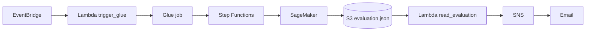

# Architecture

Pipeline AutoMLOps sur AWS : préparation des données, entraînement, évaluation et notification.

## Composants

| Service | Rôle | Fichier |
|---|---|---|
| EventBridge | Déclenche le pipeline | `eventbridge/rule_pattern.json` |
| Lambda `trigger_glue` | Lance le job Glue | `lambda/trigger_glue.py` |
| Glue | Prépare les données | `glue/automlops_ml_pipeline.py` |
| Step Functions | Orchestre les étapes | `stepfunctions/state_machine.json` |
| SageMaker | Entraîne et évalue le modèle | `sagemaker/launcher.py` |
| Lambda `read_evaluation` | Lit les métriques et publie sur SNS | `lambda/read_evaluation.py` |
| SNS | Envoie la notification | `sns/` |
